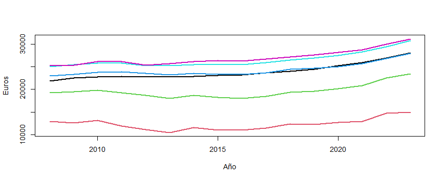
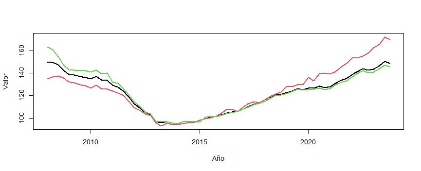
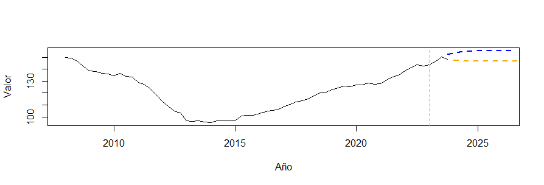

# Wages and Housing Prices in Spain

Do Spanish wages and housing prices move together, and how well can either be
forecast? A time-series analysis of INE data for 2008-2023, and an honest look
at how much 16 years of data can actually support.

Is there a long-run relationship between average wages and the Housing Price
Index (IPV), does one help predict the other, and which simple univariate model
forecasts each series best?

*Short answer:* both series are non-stationary, and a simple ARIMA(1,1,0)
forecasts most of them best out of sample. There are signs of a long-run link
between wages and the general and second-hand price indices, but **the evidence
is fragile**: it disappears for new-build housing and for workers under 35, and
the only Granger-causal effect (wages → prices) vanishes once the series are
differenced.

---

## Why this problem exists

Nominal wages rose steadily over the period: the all-ages average went from
€21,883 in 2008 to €28,050 in 2023 (+28%). Under-25s earn roughly half of that
and were the only group whose wages fell visibly during the 2010-2013 crisis.

*Black: all ages · red: under 25 · green: 25-34 · blue: 35-44 · cyan: 45-54 ·
purple: 55 and over.*

Housing prices followed a very different path: a ~37% fall from the 2008 peak
to a trough in 2013-2014, then an uninterrupted recovery. By 2023 the general
index was back at its 2008 level, and new-build housing was well above it.

Black: general index · red: new-build · green: second-hand.

Gently rising wages and crashing-then-rebounding prices are not obviously the
same process, which is what the analysis tests.

---

## Key findings

1. *Every series has a unit root.* ADF tests fail to reject non-stationarity
   for all six wage series and all three price indices (p ≥ 0.76), so models
   need at least one difference.
2. *ARIMA(1,1,0) is the best forecaster in 7 of 9 series* by out-of-sample
   MSE. The exceptions are wages for over-55s (AR(1)) and the second-hand price
   index (ARIMA(1,1,1)).
3. *In-sample and out-of-sample criteria disagree.* AIC/BIC prefer AR(1) for
   wages and ARIMA(1,1,1) for prices. Fit isn't forecasting ability.
4. *AR(1) in levels is explosive for wages.* Its coefficient is above 1
   (1.21-1.30) for five of six wage series, so its forecasts curve sharply up.
5. *Cointegration depends on the segment.* Wages are cointegrated with the
   general and second-hand indices for all ages combined and for workers 35 and
   over; never with the new-build index, never for under-25s, and only
   borderline (p = 0.044) for 25-34s with second-hand housing.
6. *Granger causality is not robust.* In a VAR(1) in levels, wages help
   predict prices (p = 0.004). In first differences the effect disappears, and
   the differenced VAR forecasts better for both variables.
7. *One quarter moves the forecast.* Dropping the last observation (2023 Q4)
   raises the 2026 Q4 price-index forecast from 146.7 to 155.7 (+6.1%).

---

## Results

Out-of-sample MSE, expanding-window one-step-ahead forecasts starting at the
middle of the sample. Lower is better; *bold* marks the best model per series.
Wage values are divided by 1,000 for readability.

### Univariate models: wages (annual)

| series | AR(1) | ARIMA(1,1,0) | ARIMA(2,1,0) | ARIMA(1,1,1) |
|---|---|---|---|---|
| all ages | 141.2 | *78.0* | 94.7 | 96.4 |
| under 25 | 838.6 | *578.9* | 579.9 | 706.3 |
| 25-34 | 660.6 | *493.7* | 518.4 | 718.9 |
| 35-44 | 242.6 | *193.2* | 224.4 | 287.1 |
| 45-54 | 179.7 | *127.1* | 163.6 | 168.9 |
| 55 and over | *283.2* | 311.8 | 473.5 | 480.0 |

### Univariate models: housing prices (quarterly)

| series | AR(1) | ARIMA(1,1,0) | ARIMA(2,1,0) | ARIMA(1,1,1) |
|---|---|---|---|---|
| general | 94.70 | *9.63* | 10.05 | 10.11 |
| new-build | 114.97 | *10.66* | 12.37 | 13.18 |
| second-hand | 96.14 | 11.07 | 11.19 | *10.23* |

### Engle-Granger cointegration (p-values of ADF on the residuals)

| wage series | general | new-build | second-hand |
|---|---|---|---|
| all ages | *< 0.01* | 0.077 | *< 0.01* |
| under 25 | 0.654 | 0.314 | 0.638 |
| 25-34 | 0.290 | 0.591 | *0.044* |
| 35-44 | *< 0.01* | 0.308 | *< 0.01* |
| 45-54 | *< 0.01* | 0.270 | *< 0.01* |
| 55 and over | *0.036* | 0.627 | *< 0.01* |

Bold means p < 0.05 (see Limitations on why these p-values are optimistic).

### VAR(1): all-ages wage and general price index

| specification | wage → price | price → wage | OOSMSE wage (/1000) | OOSMSE price |
|---|---|---|---|---|
| levels | *0.0043 (p = 0.004)* | 6.54 (p = 0.114) | 121.3 | 49.7 |
| first differences | 0.0008 (p = 0.890) | 16.21 (p = 0.123) | *93.3* | *13.9* |

The only significant cross effect is in levels, and it is small: €1,000 more
in the average wage goes with a 4.3-point rise in the index a year later.

### Forecasts (ARIMA(1,1,0))

| year | all-ages wage (€) | general price index, Q4 |
|---|---|---|
| 2024 | 29,096 | 146.9 |
| 2025 | 30,091 | 146.7 |
| 2026 | 31,036 | 146.7 |

The wage forecast extends the recent trend. The price forecast is flat: the
series dipped in its last quarter and an ARIMA(1,1,0) without drift has no
trend to extrapolate.

*Orange: ARIMA(1,1,0) on the full sample. Blue: same model estimated without
2023 Q4. The gap between them is the effect of a single observation.*

---

## Methodology

- *Stationarity first.* ADF tests decide whether models use levels or
  differences.
- *Four univariate candidates per series:* AR(1), ARIMA(1,1,0),
  ARIMA(2,1,0) and ARIMA(1,1,1), ARIMA models by maximum likelihood.
- *Model choice by out-of-sample error.* From the sample midpoint, each model
  is re-estimated on an expanding window and forecasts one step ahead. AIC and
  BIC are reported but not used to choose, since with so few observations they
  measure fit rather than forecasting.
- *Common frequency.* Quarterly prices are averaged into years, giving 16
  matching observations for the multivariate analysis.
- *Engle-Granger, then VAR.* Cointegration is tested for all 18 wage-price
  pairs; VAR(1) models follow in levels and differences, with impulse-response
  functions for the main pair.
- *Residual bootstrap* (1,000 replications) for coefficients and forecast
  bands, plus a *sensitivity analysis* dropping the last quarter of the
  general price index.

---

## Data

All data come from the Spanish National Statistics Institute (INE), national
level, 2008-2023.

- *Wages:* average annual gross earnings per worker (Wage Structure Survey),
  total and by age group (under 25, 25-34, 35-44, 45-54, 55 and over). Annual.
- *Housing Price Index (IPV):* general, new-build and second-hand dwellings,
  base 2015 = 100. Quarterly.

---

## Reproduce

The analysis is a single R script. Install the packages:

r
install.packages(c("tseries", "forecast", "vars", "writexl", "openxlsx"))

Then place wage.csv and IPV.csv (semicolon-separated, as downloaded from
INE) in the project folder, update the file paths at the top of
IPV&wage.R and in the write_xlsx() calls, and run it section by section.
Data.RData contains the loaded datasets.

## Project structure

IPV&wage.R        full analysis: descriptives, ADF, AR/ARIMA, OOSMSE,
                  cointegration, VAR, impulse-response, bootstrap, forecasts
Data.RData        wage and IPV datasets
images/           key plots used in this README
LICENSE

## Limitations

- *Sixteen annual observations.* Every multivariate result rests on 16 data
  points, and the wage out-of-sample evaluation on only 8 forecasts.
- *Engle-Granger p-values are optimistic.* The residual test uses standard
  ADF p-values instead of the stricter Engle-Granger critical values, so some
  "cointegrated" pairs would likely not survive the proper test.
- *A VAR in levels with non-stationary series* can show spurious
  significance, consistent with the wage → price effect vanishing in
  differences. An error-correction model is the natural next step.
- *Bootstrap forecast bands are not calibrated.* The 2024 95% wage band runs
  from €26,642 to €53,414: wide, asymmetric, and not a usable range.
- *Averaging quarters into years* discards within-year price dynamics.

---

## Author

[Nicolás Fernández Varela](https://github.com/NicooFdzz).
